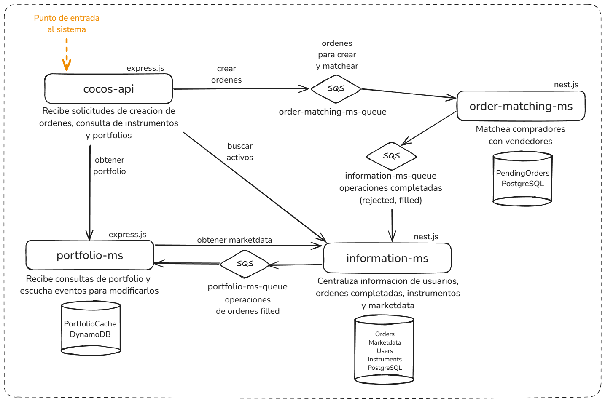

# Arquitectura

### Puntos clave
* La decision de usar microservicios y orientarlo a eventos fue para que el sistema sea mas escalable y las acciones se encuentren desacopladas unas de otras y que puedan escalar independientemente, sin que compitan en recursos entre ellas (por ejemplo, el volumen de consultas que reciba para conocer el portfolio de los usuarios es distinto al volumen o el tipo de carga que implica crear ordenes y matchearlas entre si).
* El usar SQS para la comunicacion entre servicios permite que si un servicio no esta disponible entonces la solicitud no se pierde, sino que queda persistida en el mensaje que viaja por la cola hasta que el sistema pueda procesarlo.
* Para todos los microservicios se uso nodejs, usando nest.js y typeorm para los servicios con mucha interaccion con tablas SQL dada la facilidad para integrarse con estas, el resto de los servicios se uso express.js ya que da mas versatilidad y facilidad en otros casos en los que no hay un modelo relacional (por ejemplo integraciones con SQS o con DynamoDB). Sin embargo esta fue una forma opinionada de elegir estos frameworks, la realidad es que podria haberse usado solo uno de los dos para todo, los elegi segun lo que me resultaba mas rapido de implementar en cada caso. 
* Para emular recursos de AWS (SQS, DynamoDB) uso un container de docker con Localstack.
* Se migraron las ordenes con estado `NEW` a una nueva tabla llamada `pending_orders`.

### Microservicios
* cocos-api: recibe peticiones para
    - crear una orden (evalua si pueden ser creadas y genera eventos para que ocurra)
    - buscar instrumentos
    - ver el portfolio de activos una persona
* order-matching-ms: encargado de recibir eventos de creacion de ordenes, matchear compras con ventas de manera transaccional y emitir eventos con los resultados de c/u.
* information-ms: centraliza informacion de usuarios, instrumentos, ordenes completadas y marketdata. Adicionalmente para pruebas se provee un endpoint para ingresar o egresar dinero a un usuario.
* portfolio-ms: cache de portfolio de activos de todas las personas del sistema.

# Implementacion
### Buscar instrumentos por ticker o por nombre
- Mediante `cocos-api` consultamos la busqueda del instrumento a partir de un parametro de busqueda (string). Este mismo consulta a `information-ms` el cual busca en postgreSQL en la tabla `instruments` hasta 10 activos que coincidan con el parametro de busqueda, de los cuales hasta 5 corresponden a la busqueda por ticker y hasta 5 a la busqueda por nombre.

### Obtener portfolio
- Mediante `cocos-api` consultamos el portfolio de una persona. Este mismo consulta a `portfolio-ms` el cual responde cruzando marketdata del momento obtenida de `information-ms` con data que tenga almacenado del usuario en la dynamo de `PortfolioCache`.
- El portfolio se actualiza a medida que en `information-ms` se registran ordenes ejecutadas. En ese momento el servicio emite eventos capturados por `portfolio-ms` que contiene las ordenes de compra/venta ejecutadas en una misma operacion, persistiendo para los usuarios involucrados en la operacion el nuevo monto de dinero disponible calculado a partir del cash-in/cash-out e informacion de las ordenes ejecutadas (id de instrumento, monto, precio promedio de ejecucion y cantidad).
- Para el challenge adicionalmente hay que popular la dynamo por primera vez a partir de las ordenes que ya fueron ejecutadas, esto se hace a partir de un proceso que ocurre en `information-ms` la primera vez que inicia el servicio y que genera los eventos necesarios para llenar la tabla ya que a causa de que la dynamo esta dentro de un container de localstack el mismo no persiste data. En un escenario normal se deberia ejecutar el mismo proceso una sola vez por fuera del sistema y que no dependa del inicio del servicio.

### Crear ordenes
- Mediante `cocos-api` hacemos una solicitud de creacion de orden. Este mismo verifica que la orden efectivamente pueda ser creada (es decir, que el usuario exista y que tenga la cantidad suficiente del instrumento en su portfolio en una venta o que tenga el dinero disponible para la compra). Tambien comprueba que el limite sea compatible con la operacion. Para esta verificacion consulta `information-ms` por marketdata y `portfolio-ms` y dependiendo el resultado genera o no eventos. Posteriormente en los pasos siguientes el resultado se vera impactado en el portfolio si la orden fue aceptada.
- El `order-matching-ms` escucha eventos generados para crear ordenes e intentar matchear compras y ventas, dependiendo la orden:
    - El matcheo de ordenes se realiza con una nueva tabla `pending_orders` en postgreSQL, la cual es identica a la tabla `orders` provista pero con una columna más usada para matcheo de ordenes parciales llamada `pendingpartial` de tipo booleano.
    - Las operaciones contra la nueva tabla se realizan con la opcion `FOR UPDATE SKIP LOCKED` que marca las ordenes en una seleccion como bloqueadas para escritura y lectura, esto evita que dos ordenes entrantes al mismo tiempo intenten usar las mismas ordenes.
    - Si las ordenes son de tipo `MARKET` entonces se intentara ejecutar inmediatamente. Esto quiere decir, si logra matchear con el lado opuesto de la operacion, marcara la operacion como `FILLED`, de lo contrario si no puede hacerlo la marca como `REJECTED`.
    - Si las ordenes son de tipo `LIMIT` entonces intentara matchear con el lado opuesto de la operacion. Si se completa el match entonces ambas ordenes son borradas de la tabla, en el caso de que no se complete alguna entonces se inserta la orden en la tabla con el status `NEW`. Las ordenes `LIMIT` siempre matchean unicamente con una orden.
    - Las ordenes que logran efectivamente matchear (o tambien si fueron rechazadas) son enviadas a traves de un evento a otra SQS.
    - Si las ordenes son de side `BUY` entonces prioriza la busqueda a partir del precio mas barato disponible. Adicionalmente si son de tipo `LIMIT` intentara matchear con las ordenes que tengan un precio igual o inferior al precio limite.
    - Si las ordenes son de side `SELL` entonces prioriza la busqueda a partir del precio mas caro disponible. Adicionalmente si son de tipo `LIMIT` intentara matchear con las ordenes que tengan un precio igual o superior al precio limite.
- El `information-ms` escucha los eventos enviados a la SQS del servicio de matcheo y con ello
    - persiste las ordenes y genera eventos de la manera descrita en la funcionalidad de portfolio en el caso de ordenes ejecutadas.
    - a partir de las ordenes ejecutadas se crean tambien ordenes CASH-IN/CASH-OUT segun los movimientos de dinero que ocurren a partir de estos. A su vez tambien son enviados hacia `portfolio-ms`.

# FAQ
**Por que el Marketdata no se actualiza a medida que ocurren compras y ventas?**
- Como parte de la solicitud pide no simular el comportamiento del mercado, el actualizar el marketdata quedo pendiente. Asumi que el marketdata provisto es una cache que se actualiza a partir de otro sistema hipotetico que se encarga de escuchar eventos de ordenes completadas, ir actualizando sus valores y generando eventos para que el `information-ms` los escuche y actualice su marketdata.

**Por que el precio actual de cada activo se calcula con el ultimo valor de cierre?**
- Incluido tambien en la solicitud de no simular el comportamiento del mercado y al no disponer de la unidad de tiempo en la cual ocurriran las operaciones, decidi no usar los valores de open/high/low del marketdata y simplemente usar el close. En otra iteracion se puede, usando una unidad de tiempo, detectar si el calculo de precio de activos debe hacerse dentro de horario de mercado (usando open/high/low) o fuera (usando close).

**Por que la busqueda de instrumentos busca como maximo 10 en total y maximo 5 por ticker o por nombre?**
- En la practica cuanto mas exacto sea el parametro de busqueda entonces menos resultados aparecen (hasta llegar al instrumento exacto buscado). Como la busqueda probablemente se use en una app de manera en la que a medida que escriba la persona debe poder ver resultados, implicitamente se espera que el endpoint responda rapido, es por esto que hay que poner un limite en la cantidad de resultados para mejorar la performance.
- El limite de hasta 5 y hasta 10 es arbitrario y puede cambiarse en la medida que se requiera.

**Que pasa si una persona que tiene dinero en su portfolio realiza una orden de compra de tipo LIMIT que no logra ejecutarse inmediatamente y a continuacion intenta retirar todo su dinero?**
- Hay varias acciones posibles. Podrian cancelarse automaticamente las ordenes. Podria hacer que al momento de validar la creacion de una orden bloquear el monto en su portfolio para evitar retiros. Podria asumir la perdida, la entidad financiera dueña del sistema pagar la diferencia y agregar al usuario en una lista negra para que no vuelva a operar. El challenge no aclara que deberia pasar en este caso ya que tampoco aclara la forma en la que se ingresa dinero por lo que actualmente es un bug del sistema que quedo out-of-scope de la solucion y deberia ser iterado a la brevedad.

**Que pasa si una persona realiza una orden de compra de tipo LIMIT que no logra ejecutarse inmediatamente y a continuacion realiza una orden de venta de tipo LIMIT del mismo instrumento?**
- Actualmente el sistema no tiene forma de resolver automaticamente estos casos y podria generar bugs. Quedo out-of-scope de la solucion y deberia ser iterado a la brevedad.

**Que pasa con las ordenes canceladas por el usuario?**
- Como no se detallo el mecanismo de cancelacion de ordenes, se dejo su integracion en el sistema para iteraciones futuras.